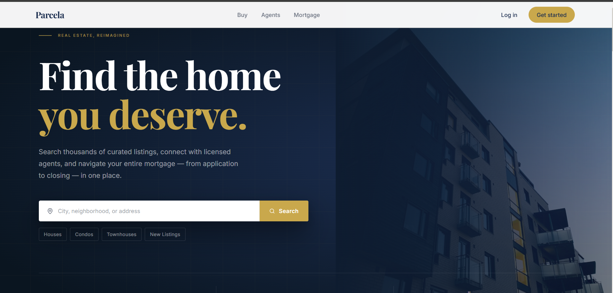
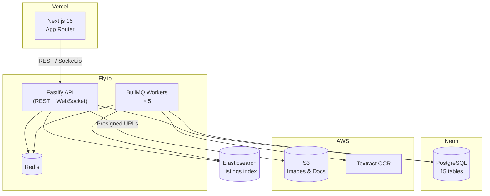
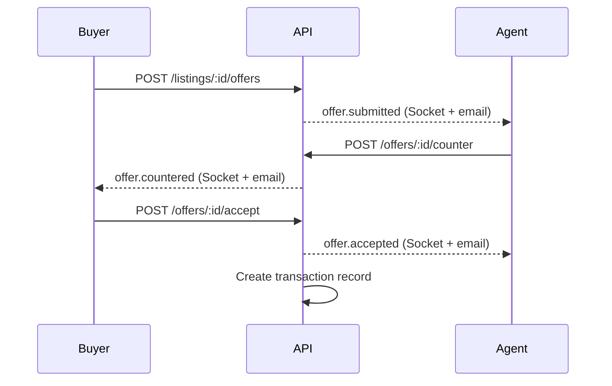
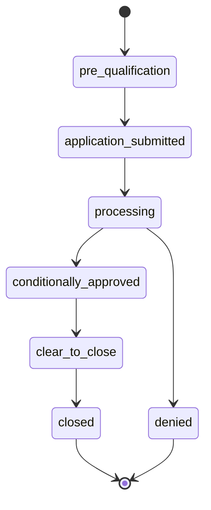

# PropNest

Real estate listing and mortgage pipeline platform. Search properties, schedule showings, negotiate offers, and track mortgage applications — end to end.

---



---

## Features

**Buyers**
- Full-text and geo-radius property search (Elasticsearch)
- Schedule and manage showings
- Submit offers with a 3-step modal — price, contingencies, review
- Counter-offer chain with earnest money and closing date negotiation
- Mortgage application pipeline with document upload and OCR parsing

**Agents**
- Create and publish listings with Cloudinary image uploads
- CRM dashboard: Kanban board across deal stages, today's showings, pending offers
- Real-time offer negotiation via Socket.io

**Admin**
- Platform stats, BullMQ queue health monitoring, user management

---

## Architecture



---

## Offer Negotiation Flow



---

## Mortgage Pipeline



---

## Monorepo Structure

```
propnest/
├── apps/
│   ├── api/          # Fastify backend — raw SQL, BullMQ, Socket.io
│   └── web/          # Next.js 15 — React Query, Zustand, Mapbox
├── packages/
│   └── shared-types/ # Shared TypeScript interfaces
└── docs/             # Architecture and API reference
```

---

## Getting Started

**Prerequisites:** Node 20+, pnpm 9+, Docker (for Elasticsearch)

```bash
# Install
git clone https://github.com/StephaneWamba/propnest.git
cd propnest && pnpm install

# Start Elasticsearch locally
docker compose up -d

# Copy env files and fill in values
cp apps/api/.env.example apps/api/.env
cp apps/web/.env.local.example apps/web/.env.local

# Run database migrations
pnpm --filter @propnest/api db:migrate

# Start development servers
pnpm dev
# → API on http://localhost:3000
# → Web on http://localhost:3001
```

---

## Environment Variables

### API (`apps/api/.env`)

| Variable | Purpose |
|---|---|
| `DATABASE_URL` | Neon PostgreSQL connection string |
| `REDIS_URL` | Redis (BullMQ + idempotency) |
| `ELASTICSEARCH_URL` | Elasticsearch endpoint |
| `JWT_ACCESS_SECRET` | 32+ char access token secret |
| `JWT_REFRESH_SECRET` | 32+ char refresh token secret |
| `AWS_ACCESS_KEY_ID` / `AWS_SECRET_ACCESS_KEY` | S3 + Textract |
| `S3_BUCKET` | Bucket for documents and images |
| `CLOUDINARY_CLOUD_NAME` / `CLOUDINARY_API_KEY` / `CLOUDINARY_API_SECRET` | Listing images |
| `RESEND_API_KEY` | Transactional email |
| `GOOGLE_CLIENT_ID` / `GOOGLE_CLIENT_SECRET` | OAuth2 |

See `apps/api/.env.example` for the full list.

### Web (`apps/web/.env.local`)

| Variable | Purpose |
|---|---|
| `NEXT_PUBLIC_API_URL` | Backend URL |
| `NEXT_PUBLIC_MAPBOX_TOKEN` | Mapbox GL map |

---

## Deployment

**API → Fly.io**
```bash
flyctl deploy --config apps/api/fly.toml --remote-only
```

**Web → Vercel**
```bash
npx vercel --prod --yes
```

**Database migrations** are run manually against Neon branches. Dev branch is pre-seeded with 20 Bay Area listings, agents, and a 5-round offer counter chain.

---

## Docs

- [Architecture](./docs/architecture.md) — services, data flow, state machines
- [API Reference](./docs/api-reference.md) — all endpoints with request/response shapes
- [Database Schema](./docs/database.md) — table definitions, indexes, relationships

---

## License

MIT
