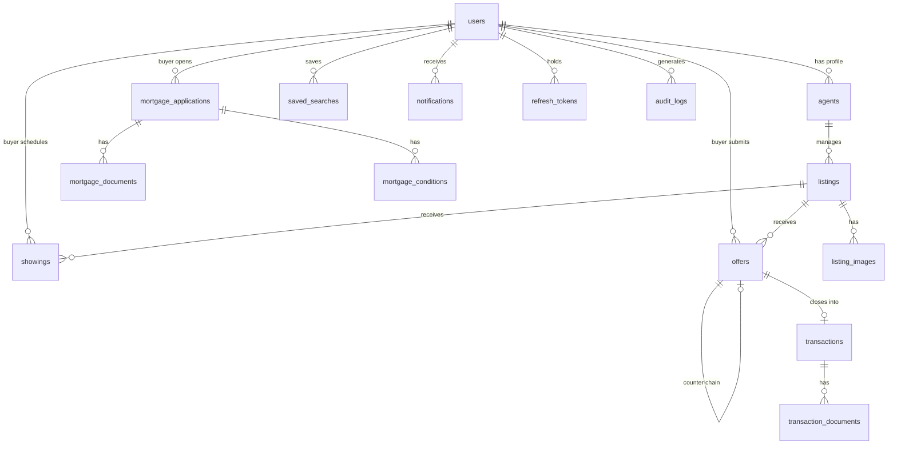

# Architecture

## Overview

PropNest is a monorepo with three packages:

| Package | Runtime | Purpose |
|---|---|---|
| `apps/api` | Node 20, Fastify | REST API + WebSocket server + BullMQ workers |
| `apps/web` | Next.js 15 | Server-rendered frontend |
| `packages/shared-types` | TypeScript | Shared interfaces and enums |

---

## API Module Structure

Each domain follows the same layered pattern:

```
modules/<domain>/
├── routes.ts     # HTTP handler registration, input parsing, auth guards
├── service.ts    # Business logic, event emission, error throwing
├── repo.ts       # Raw SQL queries via query(sql, values)
└── schema.ts     # Zod validation schemas
```

**10 domain modules:** auth, listings, showings, search, offers, transactions, mortgage, notifications, agents, crm, admin.

---

## Database

PostgreSQL (Neon) with 15 tables:



**Extensions:** `uuid-ossp`, `postgis`

All tables have `created_at` / `updated_at` columns. The `set_updated_at()` trigger fires on every `UPDATE`.

---

## Auth

- **Access tokens:** JWT, 15-minute TTL, signed with `JWT_ACCESS_SECRET`
- **Refresh tokens:** stored in `refresh_tokens` table, rotated on use, revocable
- **Google OAuth2:** buyers only, `@fastify/oauth2` plugin, redirects to `/auth/callback?accessToken=...`
- **RBAC:** `requireRole('agent')` middleware on agent-only routes; same for `admin`

**Token payload:**
```ts
{ userId: string, role: 'buyer' | 'agent' | 'admin', sessionId: string }
```

---

## Async Jobs

Five BullMQ queues backed by Redis:

| Queue | Worker | Trigger |
|---|---|---|
| `listing-sync` | listing-sync.worker | listing created/updated |
| `ocr` | ocr.worker | mortgage document uploaded |
| `notifications` | notifications.worker | any domain event |
| `pdf` | pdf.worker | transaction reaches closing |
| `scheduled` | scheduled.worker | cron (daily digest, cleanup) |

Workers start on API boot via `startWorkers()` and shut down gracefully on SIGTERM.

---

## Search

Elasticsearch index: `listings` (camelCase field names).

| Query type | Fields |
|---|---|
| Full-text | `query`, `city`, `state`, `addressLine1` (phrase_prefix) |
| Filters | `propertyType`, `status`, `minPrice/maxPrice`, `minBeds` |
| Geo | Radius search around `lat/lng` using PostGIS-compatible mappings |
| Suggest | Completion suggester on `city` and `addressLine1` |

Listings are indexed asynchronously via the `listing-sync` worker. The Elasticsearch index is rebuilt with `pnpm --filter @propnest/api es:seed`.

---

## Event System

A lightweight in-process `EventEmitter2` instance fires domain events after DB commits. Seventeen typed events cover every state transition.

```
listing.created / listing.published / listing.unlisted
offer.submitted / offer.accepted / offer.rejected / offer.countered
transaction.created
showing.scheduled / showing.confirmed / showing.cancelled
mortgage.application_submitted / mortgage.stage_advanced
document.uploaded / document.ocr_completed
notification.email_sent / notification.socket_sent
```

The notification listener in `modules/notifications/listeners/index.ts` maps every event to an email (Resend SDK) and a Socket.io push.

---

## State Machines

### Listing FSM

```
draft → active → pending → sold
              ↘ withdrawn
```

### Mortgage FSM

```
pre_qualification
  → application_submitted
    → processing
      → conditionally_approved → clear_to_close → closed
      → denied
```

---

## Storage

S3 (AWS) for two buckets:

| Bucket | Contents | Access |
|---|---|---|
| `propnest-prod-listings` | Property photos (via Cloudinary) | Presigned GET (5 min) |
| `propnest-prod-documents` | Mortgage documents | Presigned PUT (15 min) + GET (5 min) |

S3 keys are never sent to clients. All access is via presigned URLs generated server-side.

---

## Frontend State

| Concern | Library |
|---|---|
| Server data & caching | React Query (`useQuery`, `useMutation`) |
| Auth session | Zustand + localStorage |
| Map view state | Zustand |
| Search filters | Zustand |
| Realtime push | Socket.io client |

All API data is fetched as snake_case and mapped to camelCase interfaces from `@propnest/shared-types` before use in components.
